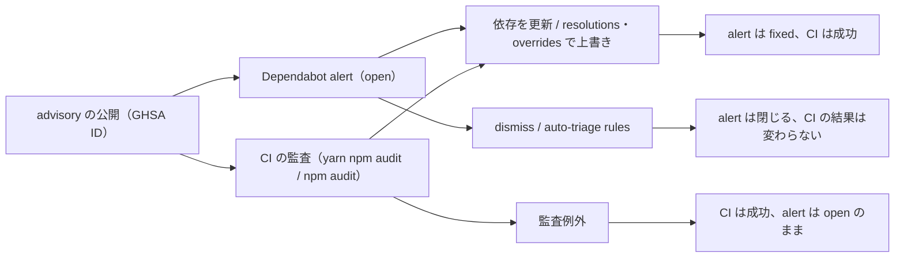

依存パッケージに advisory（脆弱性情報）が出ても、すぐに修正版へ上げられるとは限りません。修正版がまだ無い、修正版が別のメジャーにしか無い、依存元が古いバージョンを exact pin している。こうしたときのために、`resolutions` で解決バージョンを上書きする、CI の監査に期限付きの例外（監査例外）を入れる、Dependabot alert を dismiss する、といった仕組みを使います。脆弱性だけでなく、ビルドの不具合やバージョンの不整合を避けるために、`resolutions` や Dependabot の `ignore` で更新を止めることもあります。この記事では、どちらもまとめて workaround と呼びます。

個人の 4 つのリポジトリで、困るたびにこうした上書き・抑止を 1 つずつ足してきました。1 つは reusable workflow を提供するプラットフォーム、3 つはそれを呼び出す呼び出し側です。棚卸しすると仕組みは 9 つあり、同じ advisory を CI 側と GitHub 側で別々に止めているのに、互いを参照していませんでした。この記事の目標は、その現状をできるだけ分かりやすく、漏れと重複のない表で表すことです。統一の方針はまだ決めていないので、後編で扱います。

## 対象読者

- `overrides` / `resolutions`、監査の例外、Dependabot の `ignore` や dismiss を併用していて、全体を一覧したことがない人
- 「この advisory は受容した」という判断を、どこに記録するのが正しいか迷っている人
- reusable workflow で複数リポジトリに CI を配っていて、プラットフォームと呼び出し側で何が揃い、何が揃っていないかを知りたい人
- 前回記事の「回避策を削除する PR を自動で作る仕組み」を読み、対象外の仕組みがどうなっているか気になった人

[前回記事：回避策を削除する PR を自動で作る仕組み](https://zenn.dev/kmryst/articles/dependabot-ignore-overrides-removal-pr)

## 先に結論

- workaround の仕組みは 9 つ、起因と package manager、PR の update の種類で分け、起因不明も含めると 16 行になりました。止めるものは CI の監査 / Dependabot alert / Dependabot の PR / code scanning alert の 4 つです。auto-triage preset は alert を閉じ、新規 security update の PR も作らせません（上書きは「止める」のではなく検知を解消します）
- CI の監査と Dependabot alert は、同じ advisory を別々に検知しています。監査例外で CI を止めても alert は open のまま残り、alert を dismiss しても CI は止まりません。braces の 1 つの advisory が、3 つのリポジトリで CI は監査例外、alert は auto-triage rules と、別々の仕組みで止まっていました
- 上書きの台帳・外す判定と、撤去 PR の実装はプラットフォーム側だけで、呼び出し側には `overrides` の台帳も判定も届いていません。一方、ticket の `ignore` には台帳と一部のエントリの probe があり、外せると Issue コメントで知らせます。open のままの Dependabot alert 27 件は、Dependabot security updates が修正版に上げられなかったもの（`security_update_not_possible`）が 22 件、修正版そのものが無いものが 5 件で、どちらでもないものはありませんでした。そのうち 3 件だけが監査例外で CI 側で受容済みです

:::message
**運用コンテキストと前提**

- 題材は個人のポートフォリオリポジトリ 4 つ（すべて public、チームは 1 人）です。[idp-golden-path](https://github.com/kmryst/idp-golden-path)（Backstage ベースの IDP）がプラットフォームで、CI の監査や棚卸しを reusable workflow として配ります。[terraform-hannibal](https://github.com/kmryst/terraform-hannibal)、[ticket-c2c-platform](https://github.com/kmryst/ticket-c2c-platform)、[felis-ai-chatbot](https://github.com/kmryst/felis-ai-chatbot) が呼び出し側です。以下、idp / hannibal / ticket / felis と略します
- idp の依存管理は 3 系統です。Backstage 本体の `backstage/`（Yarn 4.18.1 の workspaces）、リポジトリのルート（npm）、ソフトウェアテンプレートが新しいリポジトリへ配る雛形 `skeleton/`（npm）。呼び出し側 3 つは npm です（felis は Python の uv も）
- 件数は、注記がない限り 2026-10-15 に GitHub の REST API（GET のみ）、GitHub Actions の実行ログ、リポジトリのファイルで確認した値です。Dependabot alert は `state` を問わず全件取得し、`open` / `auto_dismissed` などの状態ごとに数えています
- 仕様は 2026-10-15 時点の GitHub Docs と dependabot-core（コミット `d3fa616`）で確認しました
- この記事は現状の整理です。どう統一するかは検討中で、結論は書いていません

:::

## 用語

一次資料（GitHub Docs、npm Docs、Yarn、dependabot-core）の語をそのまま使います。日本語版 GitHub Docs では "Dependabot alerts" を「Dependabot アラート」、"code scanning alerts" を「コード スキャン アラート」、"auto-triage rules" を「自動優先順位設定ルール」と訳していますが、この記事では前回記事と揃えて英語の機能名のまま書きます。

| 用語 | 意味 |
| --- | --- |
| advisory | 脆弱性情報。GitHub Advisory Database の GHSA ID（`GHSA-xxxx-xxxx-xxxx`）で識別します |
| Dependabot alert | リポジトリの依存が advisory に該当すると GitHub が出す警告。状態は `open` / `fixed` / `dismissed` / `auto_dismissed` |
| Dependabot security updates | alert の修正版に上げる pull request を自動で作る機能。GitHub Docs では "automated pull requests that help you update dependencies with known vulnerabilities" |
| Dependabot version updates | 新しいバージョンに上げる pull request を定期的に自動で作る機能。GitHub Docs では "automated pull requests that keep your dependencies updated, even when they don't have any vulnerabilities" |
| comment commands | Dependabot の pull request にコメントで書くコマンド。`@dependabot ignore this major version` など。この記事では `@dependabot ignore` コメントと呼びます |
| Dependabot auto-triage rules | 条件に合う Dependabot alert を自動で dismiss する GitHub の機能。GitHub が用意した preset と、自分で書く custom rules があります |
| code scanning alert | CodeQL や Trivy の結果を GitHub が受け取って出す警告。依存の advisory とは別の検知です |
| CI の監査 | CI で `yarn npm audit` / `npm audit` を実行し、High / Critical があればジョブを失敗させる処理 |
| `resolutions`（Yarn）/ `overrides`（npm） | 推移的依存の解決バージョンを上書きする機能 |
| セキュリティ起因 / 非セキュリティ起因 | リポジトリでの分類です。advisory への対処として入れたものがセキュリティ起因、ビルドの不具合やバージョンの不整合への対処として入れたものが非セキュリティ起因です |
| 監査例外（audit exception） | CI の監査（`npm audit` / `yarn npm audit`）で検出された High の advisory を、期限（`expires`、最大 90 日）と追跡 Issue を付けてゲートを通す、このリポジトリの設定。設定名は `scripts/ci/yarn-audit-exceptions.json` / `npm-audit-exceptions.json` と、reusable workflow の input `yarn-audit-exceptions` / `npm-audit-exceptions` です。リスク対応の分類（[NIST の risk response](https://csrc.nist.gov/glossary/term/risk_response)）では risk acceptance に当たりますが、受け入れるのは CI のゲートだけで、Dependabot alert には及びません。リポジトリの運用ドキュメントでは見出しが「期限付き例外」になっていますが、同じものです |
| workaround（回避策） | 依存の更新や脆弱性の検知に対して、根本的な対応（依存を更新する、不具合や不整合を解消する）ができるまで一時的に入れる上書き・抑止です。セキュリティ起因と非セキュリティ起因の両方を含みます。この記事では、Yarn の `resolutions` / npm の `overrides`、監査例外、Dependabot alert の dismiss、auto-triage rules、`ignore`、pull request を閉じる、code scanning alert の dismiss を扱います |
| 台帳 | 前回記事と同じく、この記事内の呼び名です。上書き・抑止ごとに理由や対応する advisory を記録する JSON ファイルです |
| 撤去 PR | 前回記事で紹介した、不要になった上書き・抑止を削除する PR を GitHub App が自動で作る仕組みです |
| 呼び出し側 | idp-golden-path の reusable workflow を `uses:` で呼び出すリポジトリ（GitHub Docs の caller workflow を持つ側）。リポジトリの docs では消費側とも書いていて、ADR 0008 の「呼び出し側リポジトリ」と同じものです |

severity は GitHub の表示（Critical / High / Moderate / Low）で書きます。REST API では Moderate が `medium` です。

## 流れ：advisory は 2 か所で検知され、4 つの対応に分かれる

advisory が公開されると、検知は 2 か所で起きます。GitHub 側の Dependabot alert と、CI の監査です。対応によって、それぞれの結果が変わります。



依存を更新する、または `resolutions` / `overrides` で修正版に上書きすれば、advisory は依存グラフから消えます。alert は `fixed` になり、CI の監査も通ります。idp のセキュリティ起因の `resolutions` の台帳に載っている 7 つの GHSA（adm-zip 4 件、js-yaml、undici 2 件）と、ticket の `overrides` の postcss（GHSA-qx2v-qp2m-jg93）は、alert がすべて `fixed` でした。

監査例外は、リスク受容を CI のゲートに反映する設定です。dismiss は alert を閉じる操作で、リスク受容のほか誤検知などの理由でも行います。監査例外は alert を閉じず、dismiss は CI の監査結果を変えません。

## CI と alert は別々に検知していて、片方を止めてももう片方は止まらない

CI の監査は、GitHub の alert の状態を見ていません。

- `yarn npm audit` は、`npmAuditRegistry`（既定値は `https://registry.npmjs.org`）に問い合わせます
- `npm audit` は "The audit command submits a description of the dependencies configured in your project to your default registry" と説明されています

[Yarn: npmAuditRegistry](https://yarnpkg.com/configuration/yarnrc#npmAuditRegistry)
[npm Docs: npm audit](https://docs.npmjs.com/cli/v11/commands/npm-audit/#description)

そのため、対応ごとに止まる側が決まっています。

| 対応 | CI の監査 | Dependabot alert |
| --- | --- | --- |
| 監査例外 | 止まる | open のまま |
| dismiss | 止まらない | 閉じる |
| 更新・上書き | 解消 | `fixed` |

実例が braces（GHSA-vfj7-8cjw-p6xm、High、CWE-674）です。idp / hannibal / ticket の 3 つで、CI 側は追跡 Issue 付き・期限 2026-12-31 の監査例外で止めています。GitHub 側では、4 つのリポジトリの alert 8 件がすべて `auto_dismissed` でした。2 つは別々の理由と期限で止まっていて、どちらからももう片方は見えません。

## 表 1. 採用状況：どのリポジトリが何を使っているか

ここからが本題の表です。全体像から詳細へ、採用状況 → 仕組みの性質 → 件数 → open のままの alert → advisory 別の横断一覧の順に並べます。表のセルは短く、説明は表の下に書きます。

まず、4 つのリポジトリがどの検知・抑止を使っているかです。これがないと、後の表の「0 件」と「対象外」を区別できません。

| リポジトリ | 役割 | 参照（ref） | CI の監査 | 監査例外 | Dependency Unblock Check | Dependabot alerts | security updates | version updates | auto-triage preset | code scanning の送り元 |
| --- | --- | --- | --- | --- | --- | --- | --- | --- | --- | --- |
| idp | プラットフォーム | 同一リポジトリ | yarn + npm | 台帳ファイル | あり | 有効 | 有効 | npm ×3、actions | 有効 | CodeQL |
| hannibal | 呼び出し側 | `@v1`（移動 major タグ） | npm ×2 | input、root のみ | — | 有効 | 有効 | npm ×2、actions | 未確認 | CodeQL + Trivy（Golden Path 外） |
| ticket | 呼び出し側 | `@v1.7.2`（release tag） | npm ×2 | input、root + frontend | あり | 有効 | 有効 | npm ×2、actions、terraform | 未確認 | Trivy + CodeQL |
| felis | 呼び出し側 | — | — | — | — | 有効 | 有効 | npm ×2、uv、actions | 未確認 | なし |

- 参照（ref）は、依存関係の reusable workflow を `uses:` で呼ぶときの `@{ref}` です。GitHub Docs の `{ref}` は SHA / release tag / branch で、"Using the commit SHA is the safest option for stability and security" とされています。`v1` は idp の ADR 0008 の移動 major タグで、v1 系の最新に追従します。`v1.7.2` は固定です。idp は同一リポジトリの workflow なので、常にそのコミットの版で動きます。felis は依存関係の workflow を 1 つも呼んでいません
  [GitHub Docs: Reusing workflows](https://docs.github.com/en/actions/how-tos/reuse-automations/reuse-workflows)
- ticket は依存関係・セキュリティ系の workflow（dependency-audit、dependency-unblock-check、codeql、security-scan、trivy-image、trivy-config）と pr-policy-check を `@v1.7.2`、それ以外（issue-template-check、markdown-lint、pr-commitlint、sync-labels、toolchain-version-check）を `@v1` で呼んでいて、1 つのリポジトリで 2 つの ref が混ざっています
- CI の監査は idp の reusable workflow `dependency-audit.yml` です。idp は `pull_request` と週次の `schedule` で起動し、Yarn（`backstage/`）と npm の両方を監査します。hannibal は root と `client`、ticket は root と `frontend` の 2 つの caller job で呼びます。felis は依存関係の workflow を呼ばず、Golden Path 外の監査 workflow もありません
- 監査例外は、idp では台帳ファイル、呼び出し側では workflow の input（`npm-audit-exceptions`）にインラインの JSON で渡します。hannibal の `client` job には現在この input を設定していないため、例外は渡していません
- Dependency Unblock Check は、`dependabot.yml` の `ignore` を週次で「もう外せるか」試す reusable workflow です。idp と ticket だけが使っています
- Dependabot alerts と Dependabot security updates は 4 つとも有効でした（REST API の `vulnerability-alerts` と `automated-security-fixes` で確認）。version updates の列は `dependabot.yml` の `updates` エントリの内訳です
- auto-triage preset は public リポジトリで既定で有効で、4 つすべてに `auto_dismissed` の alert があります。設定画面（Settings → Advanced Security → Dependabot rules）は API がなく、idp だけ 2026-10-15 に確認しました。有効なのは GitHub preset の "Dismiss low-impact alerts for development-scoped dependencies" 1 つで、custom rules は 0 件です。呼び出し側 3 つの画面は未確認です。`auto_dismissed` の alert が残っていること（最新の `auto_dismissed_at` は hannibal / ticket が 2026-10-06、felis が 10-05）は、その時点で preset が動いた証拠にはなりますが、現在の設定の確認にはならないため、表では「未確認」としています
- この記事の表では、「未確認」は確かめる手段（設定画面など）はあるが、まだ確かめていないこと、「不明」は調べても分からなかったこと（記録がない、一次資料にない）を表します
- code scanning の送り元は、code scanning に analyses を送っているツール（`code-scanning/analyses` の `tool.name`）です。alert の件数は表 3 と表 4 に書きます。hannibal は idp の `codeql.yml` を `@v1` で呼んで CodeQL の analyses を送っていて、alert が 0 件なだけです。「Golden Path 外」は、Spotify が golden path を "the 'opinionated and supported' path to 'build something'" と定義したのに倣い、idp の reusable workflow（`trivy-image.yml` / `trivy-config.yml`）を使わず、hannibal が自分の workflow に `aquasecurity/trivy-action` を直接書いて SARIF を送っていることを指します。felis は code scanning の analyses が 404 でした
  [Spotify Engineering: How We Use Golden Paths to Solve Fragmentation in Our Software Ecosystem](https://engineering.atspotify.com/2020/08/how-we-use-golden-paths-to-solve-fragmentation-in-our-software-ecosystem)

## 表 2. 仕組みの性質：何を止め、誰が判定し、どこに記録し、どう外すか

9 つの仕組みを、起因（セキュリティ / 非セキュリティ / 不明）、package manager、PR の update の種類で分けると 16 行になります。横幅の都合で 2a〜2c の 3 つの表に分けますが、行は同じです。判定と撤去 PR がどの workflow で動くかは、表 2d にまとめます。

### 表 2a. 起因・起点・止めるもの

起点は、その仕組みを入れるきっかけになった出来事です。確認できたものは 4 つのどれかに当たり、ticket の sharp は起因・起点とも不明です。起因は導入理由で、抑止する範囲とは別です。

| 仕組み | 起因 | 起点 | CI の監査 | Dependabot alert | Dependabot の PR | code scanning alert |
| --- | --- | --- | --- | --- | --- | --- |
| Yarn `resolutions`（セキュリティ起因） | セキュリティ | GHSA の公開 | 解消 | 解消（`fixed`） | 解消 | 止めない |
| Yarn `resolutions`（非セキュリティ起因） | 非セキュリティ | 不整合・不具合の発覚 | 止めない | 止めない | 止めない | 止めない |
| npm `overrides`（セキュリティ起因） | セキュリティ | GHSA の公開 | 解消 | 解消（`fixed`） | 解消 | 止めない |
| npm `overrides`（起因不明） | 不明 | 不明 | 未確認 | 未確認 | 未確認 | 未確認 |
| npm `overrides`（非セキュリティ起因） | 非セキュリティ | 不整合・不具合の発覚 | 止めない | 止めない | 止めない | 止めない |
| 監査例外（yarn） | セキュリティ | GHSA の公開 | 止める | 止めない | 止めない | 止めない |
| 監査例外（npm） | セキュリティ | GHSA の公開 | 止める | 止めない | 止めない | 止めない |
| Dependabot alert の dismiss | セキュリティ | GHSA の公開 | 止めない | 止める | 未確認 | 止めない |
| Dependabot auto-triage rules | セキュリティ | GHSA の公開 | 止めない | 止める | 止める（preset の新規 security update） | 止めない |
| `dependabot.yml` の `ignore`（非セキュリティ起因） | 非セキュリティ | 新バージョンの公開 | 止めない | 止めない | 止める（指定条件による） | 止めない |
| `dependabot.yml` の `ignore`（セキュリティ起因） | セキュリティ | GHSA の公開 | 止めない | 止めない | 止める（指定条件による） | 止めない |
| `@dependabot ignore` コメント（非セキュリティ起因） | 非セキュリティ | 新バージョンの公開 | 止めない | 止めない | 止める（両方、範囲内） | 止めない |
| `@dependabot ignore` コメント（セキュリティ起因） | セキュリティ | GHSA の公開 | 止めない | 止めない | 止める（両方、範囲内） | 止めない |
| PR を閉じる（version update） | 非セキュリティ | 新バージョンの公開 | 止めない | 止めない | 止める（そのバージョン） | 止めない |
| PR を閉じる（security update） | セキュリティ | GHSA の公開 | 止めない | 止めない | 止める（そのバージョン） | 止めない |
| code scanning alert の dismiss | セキュリティ | CodeQL などの検出 | 止めない | 止めない | 止めない | 止める |

- 「解消」は抑止ではなく、依存を上書きして検知そのものが消えることです。前の節の `resolutions` の台帳 3 エントリ（7 つの GHSA）と `overrides` 1 エントリが実例です
- auto-triage rules だけは GitHub の自動処理で、ほかはすべて人が操作します
- auto-triage の preset で閉じる alert は、新規の security update の PR を作りません（GitHub Changelog 2023-05-02: "automatically dismissed without a notification or new pull request"。現行 Docs も "Rules are applied before alert notifications are sent" としています）。既存 PR が自動で閉じられるかと、手動 dismiss の PR への影響は未確認です
  [GitHub Changelog: Dependabot alerts now automatically dismiss false positives for npm](https://github.blog/changelog/2023-05-02-dependabot-alerts-now-automatically-dismiss-false-positives-for-npm-public-beta/)
- `ignore` の効果は起因ではなく指定条件で決まります。`update-types` だけなら version update のみ、`versions` や条件なしなら security update にも効きます。非セキュリティ起因の fastify が後者です。詳しい条件と `@dependabot ignore` コメント、「PR を閉じる」の範囲は、後の節で実装から説明します
- code scanning alert は依存の advisory ではありませんが、「alert を判断済みとして閉じる」点で同じ論点を持つため含めています

### 表 2b. 判定・記録・期限

| 仕組み | 記録の持ち主 | 記録先（idp） | 記録先（呼び出し側） | 期限 |
| --- | --- | --- | --- | --- |
| Yarn `resolutions`（セキュリティ起因） | リポジトリ | `package.json` + 台帳 | — | なし |
| Yarn `resolutions`（非セキュリティ起因） | リポジトリ | `package.json` + 台帳 | — | なし |
| npm `overrides`（セキュリティ起因） | リポジトリ | `package.json` + 台帳 | `package.json` のみ | なし |
| npm `overrides`（起因不明） | リポジトリ | 該当なし | ticket の `package.json` のみ | なし |
| npm `overrides`（非セキュリティ起因） | リポジトリ | `package.json` + 台帳（未作成） | `package.json` のみ | なし |
| 監査例外（yarn） | リポジトリ | 台帳 | — | 最大 90 日 |
| 監査例外（npm） | リポジトリ | 台帳 | workflow の input | 最大 90 日 |
| Dependabot alert の dismiss | GitHub | GitHub | GitHub | なし |
| Dependabot auto-triage rules | GitHub | GitHub | GitHub | なし |
| `dependabot.yml` の `ignore`（非セキュリティ起因） | リポジトリ | `dependabot.yml` + 台帳 | ticket は設定 + 台帳、ほかは設定のみ | 台帳ありは `review-by` |
| `dependabot.yml` の `ignore`（セキュリティ起因） | リポジトリ | `dependabot.yml` | `dependabot.yml` | なし |
| `@dependabot ignore` コメント（非セキュリティ起因） | GitHub | GitHub | GitHub | なし |
| `@dependabot ignore` コメント（セキュリティ起因） | GitHub | GitHub | GitHub | なし |
| PR を閉じる（version update） | GitHub | PR の履歴 | PR の履歴 | なし |
| PR を閉じる（security update） | GitHub | PR の履歴 | PR の履歴 | なし |
| code scanning alert の dismiss | GitHub | GitHub | GitHub | なし |

- 記録の持ち主は、記録を Git で管理できるかです。リポジトリ = リポジトリ内のファイル、GitHub = GitHub 側にしか残らない（alert の `dismissed_reason` / `dismissed_comment`、comment commands の履歴）。「PR を閉じる」は PR のイベント履歴やコメントに記録が残りますが、`ignore-conditions` のエントリにはなりません
- 台帳は idp の `scripts/ci/` にあります。`yarn-resolutions.json`、`yarn-resolutions-non-security.json`、`npm-overrides.json`（空）、`npm-overrides-non-security.json`（未作成）、`yarn-audit-exceptions.json`、`npm-audit-exceptions.json`、`dependabot-unblock.json`（`dependabot.yml` の `ignore` と 1:1）

「該当なし」はその分類の設定が現在ないこと、「—」は対象外、「なし」は記録や自動処理がないことです。「不明」「未確認」の意味は表 1 の下に書いたとおりです。

### 表 2c. 外す判定と出口

| 仕組み | 外す判定（idp） | 外す判定（呼び出し側） | 出口（idp） | 出口（呼び出し側） |
| --- | --- | --- | --- | --- |
| Yarn `resolutions`（セキュリティ起因） | 全部外して再出現を見る | — | ジョブの失敗 | — |
| Yarn `resolutions`（非セキュリティ起因） | probe ありのみ（3 件中 1 件） | — | probe ありのみ撤去 PR | — |
| npm `overrides`（セキュリティ起因） | 1 件ずつ外す | なし | 撤去 PR | なし |
| npm `overrides`（起因不明） | 該当なし | なし | 該当なし | なし |
| npm `overrides`（非セキュリティ起因） | なし | なし | なし | なし |
| 監査例外（yarn） | 未検出なら警告 | — | 警告のみ | — |
| 監査例外（npm） | 未検出なら警告 | hannibal / ticket：未検出なら警告 | 警告のみ | hannibal / ticket：警告のみ |
| Dependabot alert の dismiss | なし | なし | なし | なし |
| Dependabot auto-triage rules | GitHub がメタデータ変更時に再評価 | 同左 | 再 open する場合あり | 同左 |
| `dependabot.yml` の `ignore`（非セキュリティ起因） | probe | ticket の probe ありのみ（4 件中 2 件） | 撤去 PR | ticket の probe ありのみ exit 10 + Issue コメント |
| `dependabot.yml` の `ignore`（セキュリティ起因） | なし | なし | なし | なし |
| `@dependabot ignore` コメント（非セキュリティ起因） | なし | なし | なし | なし |
| `@dependabot ignore` コメント（セキュリティ起因） | なし | なし | なし | なし |
| PR を閉じる（version update） | なし | なし | なし | なし |
| PR を閉じる（security update） | なし | なし | なし | なし |
| code scanning alert の dismiss | なし | なし | なし | なし |

- 「全部外して再出現を見る」は、台帳の上書きをすべて外して依存を解決し直し、台帳に書いた advisory が再出現するかを見ます。前回記事で npm `overrides` について指摘された「まとめて外すと、まだ必要な上書きが不要に見える」問題を、Yarn 側はまだ抱えています
- 「probe で試しに上げる」は、上書きや `ignore` を外した状態で、台帳に書いたコマンド（依存の再解決やビルド）が通るかを見ます。非セキュリティ起因のものは advisory を持たないためです
- Yarn の非セキュリティ起因の `resolutions` で probe があるのは `@yarnpkg/core/got` だけです。npm の非セキュリティ起因の `overrides` は同期検査用の台帳形式だけが実装され、不要判定・撤去 PR の対象にはなっていません
- 呼び出し側で `ignore` の台帳と判定があるのは ticket だけです。root / frontend の TypeScript は probe あり、fastify / ioredis は `probe: false` です。hannibal / felis は `ignore` の設定だけで、外す判定・出口はありません。felis は監査例外の判定も呼んでいません
- 監査例外は、監査実行時に未検出かどうかを判定します。未検出になっても自動撤去はせず、job summary に警告が出るだけです
- auto-triage rules にはプラットフォーム独自の撤去判定はありませんが、GitHub は依存の scope や advisory のメタデータが変わったときに alert を自動で再 open する場合があります（[GitHub Docs](https://docs.github.com/en/code-security/concepts/supply-chain-security/dependabot-auto-triage-rules#about-auto-dismissing-alerts)）
- 呼び出し側の `ignore` の出口が「exit 10 + Issue コメント」になる理由は、表 2d の撤去 PR の job の条件です
- 棚卸しや監査は週次の `schedule` で動きます。連続して失敗しても、GitHub Actions 標準の失敗通知メール以外には何も起きません

### 表 2d. 判定と撤去 PR の実装場所：どの workflow の job が、どのリポジトリで動くか

表 2b / 2c の判定と出口のうち、プラットフォームが実装しているものです。残りの仕組み（dismiss、auto-triage rules、`@dependabot ignore` コメント、PR を閉じる、code scanning alert の dismiss、セキュリティ起因の `ignore`）には判定の実装がなく、GitHub の機能か設定ファイルだけです。

| 機能 | workflow | job | スクリプト | trigger | idp | hannibal | ticket | felis |
| --- | --- | --- | --- | --- | --- | --- | --- | --- |
| 台帳と `resolutions` の同期検査 | dependency-audit | `yarn-resolutions-registry` | `yarn-resolutions-audit.mjs` | `pull_request`、`schedule` | 動く | 動かない | 動かない | 呼んでいない |
| `resolutions` の判定 | dependency-audit | `yarn-resolutions-inventory` | `yarn-resolutions-audit.mjs` | `schedule` | 動く | 動かない | 動かない | 呼んでいない |
| `resolutions` の撤去 PR | dependency-audit | `yarn-resolutions-removal-pr` | `yarn-resolutions-audit.mjs` | `schedule` | 動く | 動かない | 動かない | 呼んでいない |
| 台帳と `overrides` の同期検査 | dependency-audit | `npm-overrides-registry` | `npm-overrides-audit.mjs` | `pull_request`、`schedule` | 動く | 動かない | 動かない | 呼んでいない |
| `overrides` の判定 | dependency-audit | `npm-overrides-inventory` | `npm-overrides-audit.mjs` | `schedule` | 動く | 動かない | 動かない | 呼んでいない |
| `overrides` の撤去 PR | dependency-audit | `npm-overrides-removal-pr` | `npm-overrides-audit.mjs` | `schedule` | 動く | 動かない | 動かない | 呼んでいない |
| 監査例外の判定 | dependency-audit | `dependency-audit` | `yarn-audit-policy.mjs`、`npm-audit-policy.mjs` | `pull_request`、`schedule`、`workflow_call` | 動く | 動く | 動く | 呼んでいない |
| `ignore` の判定 | dependency-unblock-check | `dependency-unblock-check` | `dependabot-unblock-check.mjs` | `schedule`、`workflow_call` | 動く | 呼んでいない | 動く | 呼んでいない |
| `ignore` の撤去 PR | dependency-unblock-check | `dependabot-ignore-removal-pr` | `dependabot-unblock-check.mjs` | `schedule`、`workflow_call` | 動く | 呼んでいない | 動かない | 呼んでいない |

- 「動かない」は、job に `if: github.repository == 'kmryst/idp-golden-path'` が付いていて、呼び出し側で `workflow_call` 経由で呼んでも skip されるものです。`resolutions` / `overrides` の 6 job はこれに加えて `package-manager` が yarn のときだけ動くため、npm で呼ぶ呼び出し側では二重に動きません。「呼んでいない」は、表 1 のとおりその workflow を caller workflow から呼んでいないものです
- `ignore` の判定は呼び出し側でも動きますが、撤去 PR の job は idp 専用です。呼び出し側では判定が「外せる」になると exit 10 と追跡 Issue へのコメントで知らせます（表 2c の出口）
- `resolutions` の撤去 PR は非セキュリティ起因の台帳が対象で、セキュリティ起因の `resolutions` は判定でジョブが失敗するだけです（表 2c）。ticket の `frontend/package.json` の `overrides` 2 件は、同期検査も判定も idp 専用のため、台帳にも棚卸しにも載っていません

:::details 表 2d の実装の補足（workflow の場所、GitHub App、job の分かれ方、参照先のコミット）

- workflow は idp の `.github/workflows/dependency-audit.yml` と `dependency-unblock-check.yml`、スクリプトは `scripts/ci/` 配下です。trigger は GitHub Docs の "Workflow triggers are events that cause a workflow to run" の意味で、`workflow_call` は呼び出し側の caller workflow から呼ばれる trigger です。どちらの workflow も `workflow_dispatch` で手動実行できます
- 撤去 PR を作る主体は GitHub App です。`actions/create-github-app-token` で App のトークンを取り、`peter-evans/create-pull-request` で PR を作ります。App は idp にしかインストールしていません
- 監査例外の判定は、idp の Yarn（`backstage/`）と呼び出し側の npm が同じ `dependency-audit` job です。idp 自身の root / skeleton（npm）だけは別 job `npm-dependency-audit`（idp 専用）で、同じ `npm-audit-policy.mjs` を使います
- hannibal の `@v1` と ticket の `@v1.7.2` は同じコミット（`dca5d23`、2026-10-13）を指していて、この表の job と `if:` 条件はどちらにも含まれています。idp の `main`（`1aa21e0`）との差分も、この 2 つの workflow にはありません

:::

## 監査例外とは何か

一覧のうち、いちばん誤解しやすいのが監査例外です。「修正版が無いときに現状を容認するもの」と思われがちですが、対象はもう少し広いものです。

**修正版を解決バージョンにできない、または方針上しない High を、期限付きで容認する設定です。**

- 対象は High だけです。Critical は例外にできません。Moderate 以下はもともと CI の監査を失敗させないので、登録しても意味がありません
- GHSA ID、期限（`expires`）、追跡 Issue を必須とし、期限は登録時点から最大 90 日です。期限が切れると CI の監査が再び失敗します
- npm 側では、開発依存を除いた監査を例外なしで先に通します。本番の実行時依存にある High は例外にできません
- 判定は idp の reusable workflow が持つので、呼び出し側でも同じルールが効きます。違うのは記録先だけで、呼び出し側は台帳ファイルではなく workflow の input に書きます

台帳の 1 件はこれだけです。

```json
{
  "id": "GHSA-c475-qrg2-pj4r",
  "expires": "2026-12-31",
  "tracking": "https://github.com/kmryst/idp-golden-path/issues/295"
}
```

### resolutions / overrides との使い分け

修正版で上書きできるなら、例外より `resolutions` / `overrides` を優先します。上書きを選ぶのは、次の 3 つをすべて満たすときだけです。

1. 修正版が、依存元の宣言している range と同じメジャーの中にある
2. `resolutions` なしで依存を解決し直しても、修正版が選ばれない（依存元が脆弱なバージョンを exact pin しているなど）
3. 上書きした状態で install / test / 型検査 / build が通る

修正版が別のメジャーにしか無い場合も、上書きせず例外で受容します。メジャーを跨ぐ上書きは、依存元が検証していない組み合わせを自分で保守することになるためです。攻撃者の入力が脆弱な処理に実際に届く High / Critical で、上流を待てない場合だけ個別に判断します（2026-10-14 に idp の ADR へ追記）。

2026-10-15 時点の例外は、4 つのリポジトリで 8 エントリ、GHSA では 4 種類です。

| リポジトリ | パッケージ | CI の監査 | 理由 |
| --- | --- | --- | --- |
| idp | basic-ftp | yarn | 修正版は別メジャー |
| idp | node-forge | yarn | 修正版なし |
| idp | braces | yarn | 修正版なし |
| idp | @graphql-tools/utils | yarn | 修正版は別メジャー |
| idp | braces | npm | 修正版なし |
| hannibal | braces | npm（root） | 修正版なし |
| ticket | braces | npm（root） | 修正版なし |
| ticket | braces | npm（frontend） | 修正版なし |

「修正版は別メジャー」の 2 件は、依存元の最新版も修正版の範囲を受け付けていないため、依存元を上げても解消しません。期限はどれも 2026-12-31 です。

## 監査例外と dismiss は、リスク受容の記録先になり得る

risk acceptance（今は直さないと決めてリスクを受け入れる）を記録する場合、CI 側は監査例外、alert 側は dismiss として別々に記録できます。ただし dismiss 全般が risk acceptance ではありません。誤検知や緩和済みも dismiss の理由で、NIST の risk response でも受容と緩和は別の対応です。

GitHub の alert を dismiss するときは、理由として dismissed reason を 1 つ選びます。値は Dependabot alert（5 値）と code scanning alert（4 値）で異なります。REST API の値で表記します。

| 判断 | Dependabot alert | code scanning alert |
| --- | --- | --- |
| リスク受容 | `tolerable_risk` | `won't fix` |
| 誤検知 | `inaccurate` | `false positive` |
| 脆弱なコードが使われていない | `not_used` | なし |
| テストコードの中でだけ使われている | なし | `used in tests` |
| 緩和済み | なし | `mitigated` |
| 修正中 | `fix_started` | なし |
| 対応の余力なし | `no_bandwidth` | なし |

[GitHub Docs: REST API endpoints for Dependabot alerts](https://docs.github.com/en/rest/dependabot/alerts)
[GitHub Docs: REST API endpoints for code scanning](https://docs.github.com/en/rest/code-scanning/code-scanning)

「判断」の列は、値の定義から読み取った対応です。リポジトリとして決めたものではありません。`not_used` は「脆弱なコードが実際には使われていない」、`used in tests` は「テストコードの中でだけ使われている」で、意味が違うため別の行にしています。

監査例外は、この判断のどれであっても同じ形（GHSA ID・期限・追跡 Issue）で記録します。どの判断で例外にしたかは追跡 Issue を読まないと分かりません。逆に dismiss には期限がありません。リスク受容を記録する場合、監査例外は判断の種類なし・期限あり、dismiss は判断の種類あり・期限なしという違いがあります。4 つのリポジトリで、手で dismiss した Dependabot alert は 0 件でした。code scanning alert の dismiss は hannibal の 32 件だけで、すべて Trivy の結果を `won't fix` で閉じたものです。

## `ignore` で止まるのは PR だけ

`ignore` は Dependabot version updates だけでなく、Dependabot security updates の PR にも効きます。options reference の `ignore` には "Security updates" の印が付いており、`@dependabot ignore` も "In Dependabot pull requests for grouped version updates and security updates, you can use comment commands to ignore and un-ignore updates" と説明されています。

ただし、security update でどの条件が効くかは指定の形で変わります。GitHub Docs には書かれていないため、Dependabot の実装（dependabot-core）で確かめました。security update のときは `versions` だけが効き、`update-types` は無視されます。条件なし（`dependency-name` だけ）の `ignore` は、内部で `>= 0` の範囲として渡されるため、security update でも全バージョンが止まります。

| `ignore` の指定 | version update | security update |
| --- | --- | --- |
| `update-types` | 止まる | 止まらない |
| `versions`（範囲） | 止まる | 範囲内なら止まる |
| 条件なし（`dependency-name` だけ） | 止まる | 止まる |

:::details 実装の抜粋と「条件なし」の解釈（dependabot-core）

```ruby
def ignored_versions(dependency, security_updates_only)
  return versions if security_updates_only
  return [ALL_VERSIONS] if versions.empty? && transformed_update_types.empty?
  # ...
```

[dependabot-core: ignore_condition.rb#L40-L46](https://github.com/dependabot/dependabot-core/blob/d3fa616f4a200a8950d1a6f1917d9f33d4f28538/common/lib/dependabot/config/ignore_condition.rb#L40-L46)
[dependabot-core: job.rb#L462-L474](https://github.com/dependabot/dependabot-core/blob/d3fa616f4a200a8950d1a6f1917d9f33d4f28538/updater/lib/dependabot/job.rb#L462-L474)

「条件なし」の行は、実装の 2 行目（`ALL_VERSIONS`）だけを読むと version update にしか効かないように見えます。しかし ticket の `fastify` の `ignore`（条件なし）は、Dependabot の実行ログの job 定義では `"version-requirement": ">= 0"` として渡されていて、`job.rb` はこれを `versions: [">= 0"]` に変換します。そのため security update でも全バージョンが止まります。fastify の alert は現在すべて `fixed` なので、今の影響はありません。

:::

4 つのリポジトリの `dependabot.yml` の `ignore` 12 件のうち 11 件は `update-types: ["version-update:semver-major"]` で、security update は止めません。idp の `@dependabot ignore` コメント 5 件は `>= 7.a, < 8` のような範囲で登録されているため、修正版がその範囲にあれば security update も止めます。呼び出し側 3 つの `@dependabot ignore` コメントは 0 件でした（各ディレクトリの最新の version update の実行ログの `ignore-conditions` で確認）。

どちらの場合も、止まるのは PR だけです。alert は open のまま残ります（"There is no interaction between the settings specified in the `dependabot.yml` file and Dependabot security alerts."）。

[GitHub Docs: About Dependabot security updates](https://docs.github.com/en/code-security/concepts/supply-chain-security/dependabot-security-updates)

## PR を閉じただけでも、そのバージョンは止まる

ignore せずに Dependabot の PR を閉じた場合の挙動は、GitHub Docs には見つかりませんでした。以下は、Dependabot の返信、実装、実行ログで確かめた内容です。

- 単独の PR を閉じると、Dependabot は "OK, I won't notify you again about this release, but will get in touch when a new version is available." と返信します。止まるのはそのバージョンだけで、新しいバージョンが出れば PR が来ます
- grouped の PR を閉じると、"This pull request was built based on a group rule. Closing it will not ignore any of these versions in future pull requests." と返信します。何も止まりません
- 実行ログでは、job 定義の `existing-pull-requests` に、数か月前に閉じた PR が入っていました。一方で `ignore-conditions` には、閉じたことによる条件はありません

実装でも、閉じた PR は既存 PR として扱われ、同じ更新先の組が既存 PR に含まれる間は、security update でも PR は作られません。

:::details dependabot-core の実装の詳細（閉じた PR が再作成を止める仕組み）

実装は version update と security update で別の operation ですが、どちらも `existing_pull_requests` で判定します。security update 側（`create_security_update_pull_request.rb`）では、`pr_exists_for_latest_version?` が「同じ依存名・最新バージョン・ディレクトリ」を含む既存 PR を見つけるか、`existing_pull_request` が「更新対象の依存の組（名前・バージョン・ディレクトリ）が同じ」既存 PR を見つけると、PR を作らずに `record_pull_request_exists_for_security_update` を記録します。閉じた PR も `existing_pull_requests` に渡されるため、同じ更新先の組が既存 PR として含まれる間は作られません。security update の更新先は "the minimum version that includes the patch"（GitHub Docs）で、dependabot-core では直接依存は `lowest_security_fix_version`、推移的依存は他を unlock せずに解決できる修正版です。新しい修正版が公開されても、この更新先が変わらなければ組も変わりません。再作成には、選ばれる更新先の組が変わるなどして既存 PR との一致を外れ、ほかの作成条件も満たす必要があります（[GitHub Docs](https://docs.github.com/en/code-security/concepts/supply-chain-security/dependabot-security-updates)、[更新先を選ぶ実装](https://github.com/dependabot/dependabot-core/blob/d3fa616f4a200a8950d1a6f1917d9f33d4f28538/common/lib/dependabot/update_checkers/base.rb#L137-L145)）。

[dependabot-core: create_security_update_pull_request.rb](https://github.com/dependabot/dependabot-core/blob/d3fa616f4a200a8950d1a6f1917d9f33d4f28538/updater/lib/dependabot/updater/operations/create_security_update_pull_request.rb)
[dependabot-core: update_all_versions.rb#L298-L311](https://github.com/dependabot/dependabot-core/blob/d3fa616f4a200a8950d1a6f1917d9f33d4f28538/updater/lib/dependabot/updater/operations/update_all_versions.rb#L298-L311)

:::

閉じたことは ignore 条件として記録されません。そのため、次の表では件数を「今も効いているもの」で数えました。4 つのリポジトリで人が閉じた Dependabot の PR は 24 件あり、そのうち今も止めているのは ticket の ioredis 6.0.0（version update）1 件だけです。security update の PR を人が閉じたものは、hannibal の qs / fast-uri / postcss と ticket の next の 4 件が実行ログで確かめられましたが、どれも対象の alert はその後 `fixed` になっていて、今は何も止めていません。

## 表 3. 棚卸し：仕組みごとの件数

対象外は「—」で、0 と区別しています。全リポジトリで 0 の行も残しています。

| 仕組み | 数える単位 | idp | hannibal | ticket | felis |
| --- | --- | --- | --- | --- | --- |
| Yarn `resolutions`（セキュリティ起因） | 台帳のエントリ | 3 | — | — | — |
| Yarn `resolutions`（非セキュリティ起因） | 台帳のエントリ | 3 | — | — | — |
| npm `overrides`（セキュリティ起因） | `overrides` のエントリ | 0 | 0 | 1 | 0 |
| npm `overrides`（起因不明） | `overrides` のエントリ | 0 | 0 | 1 | 0 |
| npm `overrides`（非セキュリティ起因） | `overrides` のエントリ | 0 | 0 | 0 | 0 |
| 監査例外（yarn） | 台帳のエントリ | 4 | — | — | — |
| 監査例外（npm） | 台帳 / input のエントリ | 1 | 1 | 2 | — |
| Dependabot alert の dismiss | alert | 0 | 0 | 0 | 0 |
| Dependabot auto-triage rules（`auto_dismissed`） | alert | 8 | 1 | 2 | 2 |
| `dependabot.yml` の `ignore`（非セキュリティ起因） | `ignore` のエントリ | 1 | 5 | 4 | 2 |
| `dependabot.yml` の `ignore`（セキュリティ起因） | `ignore` のエントリ | 0 | 0 | 0 | 0 |
| `@dependabot ignore` コメント（非セキュリティ起因） | ignore 条件 | 5 | 0 | 0 | 0 |
| `@dependabot ignore` コメント（セキュリティ起因） | ignore 条件 | 0 | 0 | 0 | 0 |
| PR を閉じる（version update、今も効いているもの） | PR | 0 | 0 | 1 | 0 |
| PR を閉じる（security update、今も効いているもの） | PR | 0 | 0 | 0 | 0 |
| code scanning alert の dismiss | alert | 0 | 32 | 0 | — |

- 「—」の理由: Yarn 系は呼び出し側 3 つが npm のため対象外。監査例外（npm）の felis は CI の監査を呼んでいないため対象外。code scanning の felis は analyses が 404 のため対象外
- 数える単位は行で違うため列にしました。braces は idp の yarn と npm の両方に入っているので、監査例外は idp で 5 エントリ・GHSA では 4 種類です
- Yarn `resolutions`（セキュリティ起因）の 3 件は `adm-zip@npm:0.6.0`、`js-yaml@npm:=4.3.1`、`undici@npm:7.29.0`。非セキュリティ起因の 3 件は `@types/react`、`@types/react-dom`、`@yarnpkg/core/got`
- npm `overrides` の「起因不明」は ticket の sharp です。`frontend/package.json` にありますが、入れた理由の記録が見つかりません。もう 1 件の postcss は PR #162 で GHSA-qx2v-qp2m-jg93 に対応して入れたものです
- `dependabot.yml` の `ignore` 12 件はすべて非セキュリティ起因（Backstage や NestJS との互換性、TypeScript 7 未対応など）です。ticket の fastify は条件なしで security update も止めますが、入れた理由は非セキュリティなので「セキュリティ起因」の行には数えていません
- ticket の ioredis は、`ignore`（semver-major）と「PR を閉じる」の両方に入っています。この表は仕組みの適用数を数えるため、1 つの依存に 2 つの仕組みが効いている場合は両方の行に 1 ずつ入ります。意図した重複です
- code scanning alert の dismiss 32 件はすべて Trivy、`dismissed_reason` は `won't fix` です

:::details 表 3 の集計方法の補足（@dependabot ignore コメント、閉じた security update の PR）

- `@dependabot ignore` コメントは、4 リポジトリ 9 ディレクトリの最新の version update の実行ログ（2026-10-12 / 10-13）の job 定義 `ignore-conditions` で、`source` が `@dependabot ignore command` のものを数えました。idp の `/backstage` に 5 件（@types/react-dom、react、react-dom、react-router、react-router-dom）、ほかは 0 件です
- 「PR を閉じる（security update）」で人が閉じた累計は hannibal 3 件（qs #629、fast-uri #628、postcss #525）、ticket 1 件（next #349）です。hannibal にはほかに 4 件、作成直前に `for postcss` / `for rollup` / `for vitest` / `for @babel/core` の Dependabot の実行がある閉じた PR がありますが、実行ログの保存期限が切れていて（HTTP 410）security update かどうかは不明です。いずれも alert は `fixed` です

:::

## 表 4. open のままの Dependabot alert：なぜ残っているか

抑止ではなく、抑止されずに残っている alert です。分類は優先順で、1 件の alert は最初に当てはまる列にだけ数えます。

| リポジトリ | Dependabot open | 例外あり | ignore が重なる | security update 不可 | 修正版なし | code scanning open |
| --- | --- | --- | --- | --- | --- | --- |
| idp | 19 | 3 | 2 | 12 | 2 | 2 |
| hannibal | 3 | 0 | 0 | 2 | 1 | 22 |
| ticket | 3 | 0 | 0 | 2 | 1 | 125 |
| felis | 2 | — | 0 | 2 | 0 | — |

- 判定基準は 4 つのリポジトリで共通です。例外あり = GHSA が監査例外の台帳 / input にある。ignore が重なる = 修正版が `ignore-conditions` の範囲に入る。security update 不可 = その alert の Dependabot security updates の実行ログに `security_update_not_possible` がある。修正版なし = alert の `first_patched_version` が null で、security update の実行自体がない
- idp の「例外あり」3 件は basic-ftp、node-forge、@graphql-tools/utils です（basic-ftp と @graphql-tools/utils は security update の実行も `security_update_not_possible`、node-forge は修正版なし）。CI 側では受容済みなのに、Security タブでは未対応に見えます。例外を入れたら alert をどうするかは、運用ドキュメントのどこにも書いていません
- idp の「ignore が重なる」2 件は react-router の Moderate な alert です。修正版は 7.18.0 以上で、`@dependabot ignore` コメントの `react-router-dom >= 7.a, < 8` に入ります。ただし ignore を外しても直りません。Backstage の各パッケージが `react-router-dom` 6 系を peerDependencies で要求しているため、security update の実行も `security_update_not_possible` で終わっています。非セキュリティ起因で入れた ignore が、どの advisory と関係しているかが、どの記録からも読み取れません
- 「security update 不可」は、Dependabot が修正版に上げようとして失敗したものです。idp の 12 件は smol-toml ×2、katex ×2、postcss-selector-parser、got、uuid、@octokit/plugin-paginate-rest、@octokit/request、@octokit/request-error、prismjs、file-type で、各 alert の最新の実行ログ（2026-08-16 〜 10-12）で確認しました。hannibal / ticket / felis の 2 件はどれも katex と smol-toml です。4 つのリポジトリで同じ 2 つの advisory が、同じ理由で open のまま残っています
- 「修正版なし」は elliptic（idp）と sprintf-js（idp / hannibal / ticket）です。`first_patched_version` が null で、Dependabot は security update の job を作りません。severity はどれも Moderate / Low で、CI の監査の対象にもなりません
- code scanning open は idp が CodeQL 2 件、hannibal が Trivy 22 件、ticket が Trivy 124 件 + CodeQL 1 件です
- CI の監査は Moderate 以下を失敗させないので、Moderate / Low の alert はそもそも監査例外の対象になりません。idp の open 19 件のうち 16 件が Moderate / Low で、受容の判断を記録する場所がありません

## 表 5. advisory 別の横断一覧：同じ advisory が 4 つのリポジトリでどう扱われているか

表 3・表 4 の件数のうち、2 つ以上のリポジトリに alert が出た advisory で、open または `auto_dismissed` の alert があるものだけを抜き出したものです。セルは「扱い; alert の状態 × 件数」で、件数は manifest ごとの alert 数です。code scanning は対象外です。

| advisory | パッケージ | severity | idp | hannibal | ticket | felis |
| --- | --- | --- | --- | --- | --- | --- |
| GHSA-vfj7-8cjw-p6xm | braces | High | 例外 yarn + npm; auto_dismissed ×3 | 例外 npm; auto_dismissed ×1 | 例外 npm ×2; auto_dismissed ×2 | auto_dismissed ×2 |
| GHSA-7mx3-vvmw-hjmv | @graphql-tools/utils | High | 例外 yarn; open ×1 | fixed ×1 | — | — |
| GHSA-r4xh-jqrq-34v2 | smol-toml | Moderate | open ×2 | open ×1 | open ×1 | open ×1 |
| GHSA-238p-pmpm-9mq7 | katex | Low | open ×2 | open ×1 | open ×1 | open ×1 |
| GHSA-hp3w-g68c-fv3c | sprintf-js | Moderate | open ×1 | open ×1 | open ×1 | — |
| GHSA-w5hq-g745-h8pq | uuid | Moderate | open ×1 | fixed ×1 | — | — |
| GHSA-4mjr-xmp4-gh2g | qs | Moderate | auto_dismissed ×1 | fixed ×1 | — | — |
| GHSA-x5fp-wj9c-mxmx | qs | Moderate | auto_dismissed ×1 | fixed ×1 | — | — |
| GHSA-v422-hmwv-36x6 | body-parser | Low | auto_dismissed ×1 | fixed ×1 | — | — |

- 「—」はそのリポジトリに alert が出ていないことです。「例外」は監査例外（期限はすべて 2026-12-31）
- この表は表 3 / 表 4 の件数を advisory 単位に分解したもので、合計は表 3 / 表 4 にしかありません。全リポジトリで `fixed` の advisory（js-yaml、undici、postcss、fast-uri、brace-expansion など）は載せていません
- braces は、CI は監査例外で止め、alert は preset で `auto_dismissed` です。felis は CI の監査を呼んでいないため例外がなく、alert だけが閉じています。例外を入れたから閉じたのではなく、手で dismiss した alert は 0 件です。preset の条件は、ecosystem が npm、scope が development、そして GitHub が選んだ CWE（リソース消費やエラー処理などの 23 種）に当たることの 3 つで、severity は条件に含まれません。そのため CWE-674（Uncontrolled Recursion）の braces は High でも閉じられています。GitHub Docs ではこのルールを "Dismiss low impact issues for development-scoped dependencies" と書いています
- @graphql-tools/utils は、idp では修正版が別メジャーのため例外で受容し alert は open、hannibal では更新して `fixed` です。同じ advisory への対応が、リポジトリで違います
- idp の auto_dismissed 8 件のうち、例外と重なるのは braces の 3 件だけです。残りの 5 件（pbkdf2、colord、qs 2 件、body-parser）は、どの台帳にも、運用ドキュメントにも出てきません。GitHub 側の状態としてだけ存在し、受容した理由も期限もありません

[GitHub Docs: Dependabot auto-triage rules](https://docs.github.com/en/code-security/concepts/supply-chain-security/dependabot-auto-triage-rules#dismiss-low-impact-issues-for-development-scoped-dependencies)
[GitHub Docs: CWEs used by GitHub's preset Dependabot rules](https://docs.github.com/en/code-security/reference/supply-chain-security/criteria-for-preset-rules)

## 今後の検討候補

統一の方針を決める材料として、使っていない公式の機能と、一覧から外した境界を並べます。結論はまだ出していません。

- **`npmAuditIgnoreAdvisories` / `yarn npm audit --ignore`**: Yarn 公式の、advisory を監査結果から除く機能です。期限を持たず、照合するのは npm registry の advisory ID なので、GHSA ID の台帳とは突き合わせられません。idp が独自の監査例外を作った理由はここにあります
- **期限付きで受け入れる仕組みの他ツールでの実装例**: 監査例外と同じ考え方は、Trivy や Snyk などの依存スキャナにも組み込まれていて、ignore に期限を付けられます。hannibal の code scanning alert の dismiss 32 件は Trivy の結果ですが、`.trivyignore` ではなく GitHub 側の `won't fix` で、期限はありません
- **`--severity high` / `--audit-level=high` の閾値**: 恒久の設定ですが、open な Moderate / Low の alert に記録先が無いのは、この閾値が原因です
- **呼び出し側の `overrides`**: 台帳と棚卸しは idp 専用で、ticket の 2 件は何にも追跡されていません

:::details Trivy / Snyk の期限付き ignore の仕様

Trivy の `.trivyignore` は `CVE-2019-14697 exp:2023-01-01` の形で期限を付けられ、公式の例ではこれを "Accept the risk until 2023-01-01" と説明しています（`.trivyignore.yaml` では `expired_at`。"If expired_at is not set, the ignore finding is always valid."）。Snyk の ignore は "An issue is ignored until either of these conditions occurs: the ignore period expires, or the vulnerability becomes fixable" で、CLI では `snyk ignore --id=… --expiry=… --reason=…` です。

[Trivy: Filtering](https://trivy.dev/docs/latest/configuration/filtering/)
[Snyk: Ignore issues](https://docs.snyk.io/scan-fix-and-prevent/fix/prioritize-issues-for-fixing/ignore-issues)

:::

一覧から外した境界もあります。Yarn の `npmMinimalAgeGate`（公開から一定期間たっていないバージョンを解決の候補から外す）と、Dependabot の `cooldown`（version updates を一定日数遅らせる。既定で 3 日）は、修正版の取り込みも遅らせますが、特定の advisory やパッケージを対象にしない一律のポリシーなので、一覧に入れていません。非セキュリティ起因の `resolutions` のうち `@types/react` / `@types/react-dom` は、解除条件の無い方針として入れたもので、「一時的」に当たるかは判断が分かれます。

## まとめ

9 つの仕組みは、どれも入れた時点では合理的でした。CI を止めないための例外、Backstage との互換性を守るための ignore、Security タブを整理するための auto-triage rules。表にして見えたのは、1 つの advisory に対する判断が CI 側と GitHub 側に分かれて記録され、それぞれが別の基準で期限と出口を持っている（または持っていない）ことと、上書きの台帳・判定と撤去 PR がプラットフォーム側だけにあり、呼び出し側の `overrides` はその管理対象に入っていないことです。呼び出し側でも ticket の `ignore` には台帳と一部のエントリの probe があり、出口は撤去 PR ではなく Issue コメントです。

自分のリポジトリで同じ棚卸しをするなら、まず「この advisory を受容した」という判断がどこに記録されているかを、GitHub 側の状態も含めて洗い出すのが入口になると考えています。台帳を持つ仕組みだけを見ていると、`auto_dismissed` の 13 件や `@dependabot ignore` コメントの 5 件を見落とします。

後編では、これらの台帳・判定基準・出口を、どこまでプラットフォームで共通化し、どこから先を GitHub 側の状態に任せるかを検討した結果を書く予定です。
